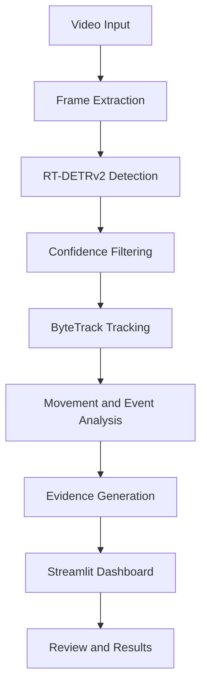

# SnakeWatch
### Real-Time Snake Detection and Farmer Alert System

SnakeWatch is an AI-powered computer vision research project designed to detect potential snake intrusion in video footage, track detected objects, and provide visual alerts through an interactive dashboard.

> **Research prototype:** SnakeWatch provides model-based detections. It is not a certified safety system, and an alert does not confirm the presence of a snake.

## Key Features

- Fine-tuned RT-DETRv2 snake detection.
- ByteTrack multi-object tracking.
- Video analysis and annotated output generation.
- Detection metrics and provisional alert classification.
- Interactive Streamlit dashboard.
- Boundary Simulation and movement-state analysis.
- Evidence generation and event review.
- Human Safety Monitoring.

## Technology Stack

| Component | Technology |
|---|---|
| Programming Language | Python |
| Object Detection | RT-DETRv2 |
| Object Tracking | ByteTrack |
| Deep Learning | PyTorch |
| Computer Vision | OpenCV |
| Dashboard | Streamlit |
| Model Utilities | Transformers |
| Development | Google Colab, VS Code |

## System Architecture



## Main Modules

### Live Detection
Processes video frames using RT-DETRv2 and ByteTrack, producing annotated detections and tracking information.

### Boundary Simulation
Supports boundary-based monitoring, movement analysis, event summaries, evidence generation and review.

### Human Safety Monitoring
Provides a separate monitoring workflow for detecting people and potential snake activity using configured danger zones.

## Detection and Evaluation

Evaluation areas include:
- Precision, recall and mean Average Precision (mAP).
- Snake recall and false-positive analysis.
- Hard-negative evaluation using visually similar objects.
- Tracking consistency.
- Inference speed and processing throughput.

## Installation

Create a virtual environment:

```bash
python -m venv .venv
```

Activate it on Windows:

```powershell
.venv\Scripts\activate
```

Install dependencies:

```bash
pip install -r requirements.txt
```

Configure the model checkpoint and local dataset/video paths as required.

## Run the Dashboard

```bash
streamlit run app/snakewatch_speed_test.py
```

## Model and Dataset

The project uses an RT-DETRv2 model based on `PekingU/rtdetr_v2_r18vd`.

Model weights, datasets and large input videos are not included in this repository by default. Their availability and licensing should be checked separately.

## Limitations and Safety

- Performance depends on image quality, lighting, camera angle and training data.
- Visually similar objects may cause false detections.
- Detection rate does not establish the probability of a snake being present.
- Boundary zones use image coordinates and are not calibrated physical distances.
- This is a research prototype, not a certified safety system.

Never approach or handle an unidentified animal based solely on a dashboard alert.

## Future Improvements

- Improve robustness against hard-negative objects.
- Evaluate performance in varied environments.
- Improve zone-based intrusion analysis.
- Optimize inference for edge devices.
- Improve notification and event-monitoring capabilities.

## License

A suitable license has not yet been specified. Add one after confirming ownership and redistribution permissions for the code, model and dataset.

---

**SnakeWatch - Detect. Track. Review.**