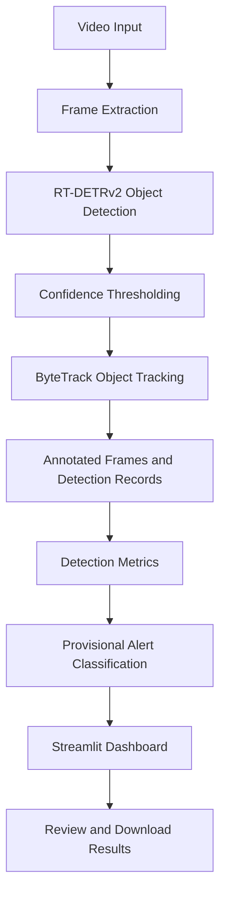

# 🐍 SnakeWatch
### Real-Time Snake Detection and Farmer Alert System

An AI-powered computer vision project designed to detect snake-like objects in video footage, track detections across frames, and present visual alerts through an interactive dashboard. SnakeWatch aims to support early awareness of potential snake intrusion in agricultural and residential surroundings.

> **Research prototype:** SnakeWatch provides provisional, model-based detections. It is not a certified safety system, and an alert does not confirm the presence of a snake.

---

## 📌 Overview

Snake intrusion can pose risks to farmers, livestock, and people living near agricultural fields. Manual monitoring of large areas can be difficult, particularly in low-visibility or remote environments.

SnakeWatch explores how deep learning and object tracking can assist with identifying potential snake activity in video footage. The system combines object detection, multi-object tracking, video annotation, and a Streamlit-based dashboard to make detection evidence easier to review.

## ✨ Key Features

- **Deep Learning-Based Detection:** Uses a fine-tuned RT-DETRv2 object detection model to identify candidate snake objects.
- **Object Tracking:** Integrates ByteTrack to associate detections across video frames.
- **Video Analysis:** Processes uploaded or configured video inputs and generates annotated output when supported by the runtime.
- **Graded Alerts:** Classifies detection activity into provisional alert levels based on the percentage of processed frames containing detections.
- **Detection Metrics:** Displays detection rate, model confidence, alert level, and consecutive detection evidence.
- **Interactive Dashboard:** Uses Streamlit to provide a visual interface for running inference and reviewing results.
- **Annotated Results:** Supports viewing and downloading generated output videos and saved frames when available.

## 🧠 Technology Stack

| Component | Technology |
|---|---|
| Programming Language | Python |
| Object Detection | RT-DETRv2 |
| Object Tracking | ByteTrack |
| Deep Learning Framework | PyTorch |
| Computer Vision | OpenCV |
| Detection Visualization | Supervision |
| Dashboard | Streamlit |
| Model Utilities | Transformers, Accelerate, Safetensors |
| Development Environment | Google Colab, VS Code |
| Public Demo Access | Cloudflare Tunnel (optional) |

## 🏗️ System Architecture



## ⚙️ Detection and Alert Methodology

### 1. Object Detection

The RT-DETRv2 model processes video frames and generates candidate detections with bounding boxes and confidence scores. A confidence threshold is used to filter detections before subsequent processing.

### 2. Object Tracking

ByteTrack associates detections across successive frames to help maintain object identities and examine the persistence of detected activity.

### 3. Detection Metrics

The dashboard uses frame-level evidence to summarize detection activity.

**Detection rate**

\[
\text{Detection Rate} =
\frac{\text{Frames with detections}}
{\text{Processed frames}}\times 100
\]

The model confidence score represents the detector's output score; it is not a calibrated probability that an object is a snake.

### 4. Provisional Alert Levels

The current alert configuration uses these detection-rate thresholds:

| Detection rate | Alert level | Interpretation |
|---|---|---|
| Below 15% | No Confirmed Alert | Insufficient detection activity for a higher alert |
| 15% to below 30% | Moderate | Possible snake-like activity |
| 30% to below 50% | High | Persistent detection activity |
| 50% or above | Critical | Sustained detection activity |

These thresholds are configurable engineering heuristics, not scientifically validated risk boundaries. A low detection rate does not establish that an area is snake-free, and false positives may occur.

## 🚀 Getting Started

### Prerequisites

- Python environment compatible with the installed PyTorch and Transformers versions
- Git
- The project's Python dependencies
- Access to the trained RT-DETRv2 checkpoint
- A compatible video file for testing

### 1. Clone the Repository

```bash
git clone https://github.com/YOUR-USERNAME/SnakeWatch.git
cd SnakeWatch
```

Replace `YOUR-USERNAME` with your GitHub username.

### 2. Create a Virtual Environment

```bash
python -m venv .venv
```

Activate it on Windows:

```powershell
.venv\Scripts\activate
```

On Linux or macOS:

```bash
source .venv/bin/activate
```

### 3. Install Dependencies

```bash
python -m pip install --upgrade pip
pip install -r requirements.txt
```

### 4. Configure the Model Checkpoint

Obtain the trained model checkpoint from an authorized source and configure the dashboard to use its actual local path.

**Note:** Model weights, datasets, and large videos are not included in this repository by default. The dashboard may require path configuration before it can run.

### 5. Launch the Dashboard

```bash
streamlit run snakewatch_live_app_modified.py --server.port 8502
```

Open the local URL printed by Streamlit, usually:

`http://localhost:8502`

The exact launch configuration may need adjustment depending on the app's input settings, checkpoint path, and runtime environment.

## 📂 Repository Structure

```text
SnakeWatch/
├── README.md
├── requirements.txt
├── .gitignore
├── snakewatch_live_app_modified.py
├── scripts/
│   ├── step1_dataset_collection.py
│   ├── step2_annotation_validation.py
│   ├── step3_dataset_split.py
│   ├── step4_1_coco_dataset_class.py
│   ├── step4_2_bbox_handling.py
│   ├── step4_3_augmentations.py
│   ├── step4_4_rtdetr_processor_dataloader.py
│   └── ...
├── evaluation/
│   └── evaluate_sensitivity_presets.py
└── docs/
    └── RUN_LIVE_APP_COLAB.md
```

*This is a suggested structure. Keep only directories and files that actually exist in your repository, and include all custom modules required by the application.*

## 🧪 Testing and Evaluation

Useful evaluation areas for this project include:

- Precision, recall, and mAP for object detection
- False-positive analysis using visually similar objects such as ropes and hoses
- Tracking consistency across consecutive frames
- Detection-rate behavior under different confidence thresholds
- Inference speed and processing throughput
- Robustness under different lighting, backgrounds, and camera conditions

Evaluation results should be reported only after testing on a defined dataset and recording the actual measurements.

## ⚠️ Limitations and Safety

- The model can confuse snakes with visually similar objects.
- Performance depends on image quality, lighting, camera angle, and training data.
- Detection rate is not equivalent to the probability of a snake being present.
- Persistent tracking does not prove that the detected object is a snake.
- The current dashboard does not implement a fully calibrated distance estimate or complete zone-based risk assessment.
- Automated alerts should not replace trained human verification or established safety procedures.

If a snake is suspected, maintain a safe distance and contact appropriate trained assistance. Never approach or attempt to handle an unidentified animal based solely on the dashboard output.

## 🔮 Future Improvements

- Improve robustness against hard-negative objects and background clutter.
- Evaluate detection performance across different environments.
- Add validated zone-based intrusion logic.
- Integrate camera-stream inference and deployment monitoring.
- Investigate reliable notification delivery and event logging.
- Optimize inference latency for edge devices.
- Evaluate distance estimation and risk classification independently before deployment.

## 👩‍💻 Project Purpose

SnakeWatch is a computer vision research and engineering project exploring how object detection and tracking can support snake-intrusion awareness. Its objective is to make potential detection events easier to observe, review, and evaluate.

## 📄 License

No license has been specified yet. Add a suitable license after confirming the ownership and redistribution permissions for the source code, model, and dataset.

---

**SnakeWatch — Detect. Track. Review.** 🐍
